# Semper Classroom operating manual

How to get displacement and strain fields out of a DIC image set, using the app.

Semper Classroom (Material Testing before ADR-030) is Semper with two lab
tests added. **+** asks which test it is: **2D DIC** is Semper's analysis,
unchanged, and everything in §1–§11 is about it; **Tensile** and **Bending**
add a load log, the specimen's size, a **Results** page with E, and a lab
report ([§12](#12-lab-tests)).

Lighting, rig stability, and the measurement floor — why they dominate strain
noise on a static check — are covered in
[app/NOISE_FLOOR_STRAIN_ACCURACY.md](app/NOISE_FLOOR_STRAIN_ACCURACY.md). For
broader DIC practice (speckle paint, cameras, calibration), see *A Good
Practices Guide for Digital Image Correlation* (iDICs). This manual starts once
you have images.

<!-- **For:** a graduate researcher who knows DIC basics — subsets, correlation,
strain fields — and has not used this app. -->

| | |
|---|---|
| [1. What it does](#1-what-it-does) | [7. Parameter sweeps](#7-parameter-sweeps) |
| [2. Getting in](#2-getting-in) | [8. Reading results](#8-reading-results) |
| [3. Images it accepts](#3-images-it-accepts) | [9. Exports](#9-exports) |
| [4. Running an analysis](#4-running-an-analysis) | [10. Managing analyses](#10-managing-analyses) |
| [5. Parameters](#5-parameters) | [11. Troubleshooting](#11-troubleshooting) |
| [6. Region of interest](#6-region-of-interest) | [12. Lab tests](#12-lab-tests) |

---

> **`delete-dialog.png` below still shows the pre-2026-08 UI** — recapturing it
> needs a signed-in account with a cloud-backed analysis. `home.png` shows the
> list as of 2026-10-10, but only local analyses, so every cloud icon reads *Not
> backed up*; the other cloud states and the Settings **Download** row still need
> a real-account pass. `settings.png` shows the
> current UI but only its local-only state. Every other screenshot on this page
> matches the current UI. The diagrams
> (`pipeline.svg`, `wizard.svg`, `subset-step.svg`, `vsg.svg`, `lattice.svg`) are
> conceptual, not screen captures, and are current. Remaining work:
> [images/CAPTURE_CHECKLIST.md](images/CAPTURE_CHECKLIST.md).

## 1. What it does

You give it one reference frame and N deformed frames. It matches subsets on a
grid and returns five fields per frame.

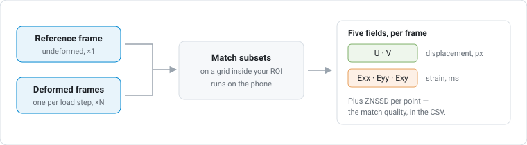

| Field | Unit |
|---|---|
| **U**, **V** — displacement | px |
| **Exx**, **Eyy**, **Exy** — strain | mε (millistrain) |

Two things to know up front:

- **Displacements are in pixels.** There is no scale calibration. Convert to
  physical units yourself.
- **Everything runs on the phone.** Cloud backup stores results only.

---

## 2. Getting in

Accounts need approval, not just sign-up.

1. Sign in with Google or email.
2. **Passwords** need 8+ characters with upper and lower case, a digit and a
   special character. **Generate secure password** fills a strong one in for you
   and reveals it so you can save it. **Forgot password** mails you a link;
   opening it on this device reopens the app on a set-new-password form, where
   the same rules apply. You never leave the app to reset a password.
3. **Signing up with email?** Creating the account sends a verification link and
   puts you back on the sign-in form with your address still filled in. Open the
   link, then sign in there. Until you do, sign-in is refused and a fresh link is
   sent each time you try.
4. New accounts land on **Pending approval**. Support is emailed automatically
   at this point — you do not have to ask to be noticed.
5. Tap **Request access** if you want to add context. It opens a prefilled
   email; send it.
6. After an admin approves you, tap **Check status**.

**Nothing polls.** The screen never updates on its own. Use the button.

Google and email-link sign-ins skip step 2 — both already prove the address.

Offline works if you have been approved on this device before. Import, solve and
read results all work without a network. Uploads wait.

**Crash reports are opt-in.** After the beta notice on first run the app asks
once whether it may send crash diagnostics. Nothing is collected unless you say
yes, and you can change your mind at any time under **Settings → Your data →
Send crash reports**.

**First-run tips.** The first time you reach a screen, a short tip card points
at the control it describes, with the rest of the screen dimmed. When a screen
has several tips the card counts them ("1 of 3") and offers **Skip** beside
**Next**; the last tip, and a screen with only one, shows **Got it**. Skip or
Got it puts that screen's tips away for good.

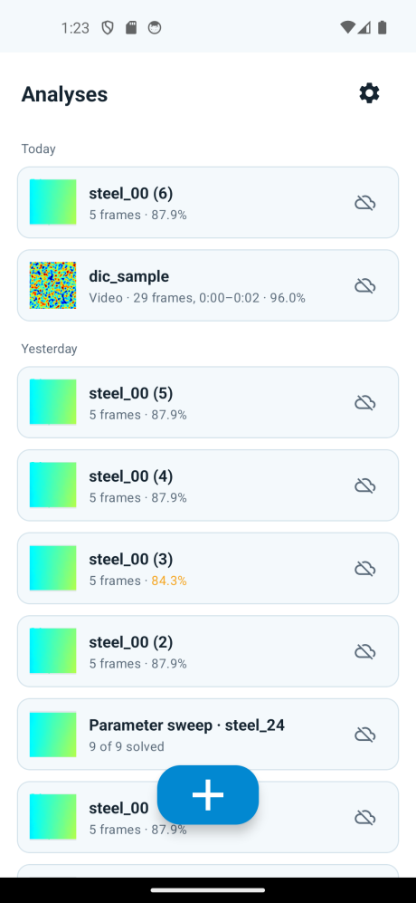

The app icon follows your phone's dark theme: the S in black on a light
disc, or in white on jet black. It changes the next time the app is open after
you switch. With **Themed icons** on (Wallpaper & style), the launcher tints
it with your wallpaper's colours instead.

Home lists your analyses. Tap one to open it. Long-press for select, rename,
delete. Pull down to sync. **+** asks which test it is — **2D DIC**, **Tensile**
or **Bending** ([§12](#12-lab-tests)) — then opens the picker: pick existing
photos or a video. There is no in-app camera; the app measures images you
already have.

The list is grouped by day under small headers: *Today*, *Yesterday*, then a
date such as *Oct 7* (with the year for an earlier year), in your phone's
language and timezone. Each analysis is a card showing the last frame's U
displacement as its thumbnail (the reference image until that is drawn, or when
the frames are not on the phone), the name, and a line such as
`40 frames · 96.3%`: the frame count and the share of points that converged.
A convergence under 85% is amber. A run that stopped early reads
`39 of 50 frames` and ends with why it stopped; a parameter sweep reads
`9 of 9 solved`. A video analysis says so, with where its frames sit in the
clip: `Video · 40 frames, 0:00–0:12 · 91.2%`. A selected card turns light blue.
A new analysis is named after its reference image without the image's
extension, `steel_00` (a dotted name such as `tensile.v2` stays whole);
a second one from the same image becomes `steel_00 (2)`. A video analysis is
named after the clip, `tensile_03` from `tensile_03.mp4` (`Video` when the
clip's name cannot be read), and a sweep after its frame, `steel_24 sweep`.
No two analyses on the phone share a name: a restored one, or a rename to a
name already in the list, takes the next `(2)`, `(3)` (a rename says
"Saved as …"). A restore keeps the name the analysis had when it was backed
up; an old auto-name reads as today's (`steel_00 · Oct 9, 17:57:31` and
`steel_00.png` restore as `steel_00`). Rows an earlier version left sharing a
name, or named `steel_00.png`, are put right the same way when the list
loads (the oldest keeps the plain name); other names stay. The cloud icon at the
row's end says where the backup stands:

| Icon | Means |
|---|---|
| Cloud with a tick | Backed up |
| Cloud with an up arrow | Upload pending, or backing up now |
| Crossed-out cloud | Not backed up (red: the backup failed) |
| Cloud with a down arrow | Only in cloud, or restoring now |

While a backup or restore runs, a thin bar under the row fills and the line
reads `Backing up · 35.0%`.

---

## 3. Images it accepts

Hard rules:

| Rule | If broken |
|---|---|
| All frames the same pixel size as the reference | Blocking error; you cannot run |
| At least one reference + one deformed frame | **Next** stays off |
| At most *Max frames* (default 50) | Extras dropped, with a toast |

**Formats.** PNG and TIFF are best. JPEG works but raises an accuracy warning —
compression damages the intensity gradients correlation needs. RAW and DNG
import **only through Files**, not Photos.

**Texture check.** On import the app measures your speckle. Weak pattern → a
warning naming a bigger subset size. Treat it as a comment on the pattern, not
just a setting.

**Video.** Pick a video and a sampling sheet opens: **Keyframes** or
**Interval** (the ⓘ beside them says what each extracts), a frame rate for
Interval, the segment, and for Interval a live frame-count estimate. Frame 0
becomes the reference, named after the clip, and each frame keeps its time in
the clip. While the video's
length and frame rate are read, the reference slot shows a small spinner and
**Reading video…**.

**While a reference decodes.** If it takes longer than about a third of a
second, the reference slot shows a grey placeholder thumbnail and **Decoding
image**, or **Decoding RAW · 24 MP** for a RAW or DNG (the megapixels only when
the file's header gives its size). A quick decode shows nothing. With
animations turned off in Android's settings, the placeholder holds still and
spinners are left out.

---

## 4. Running an analysis

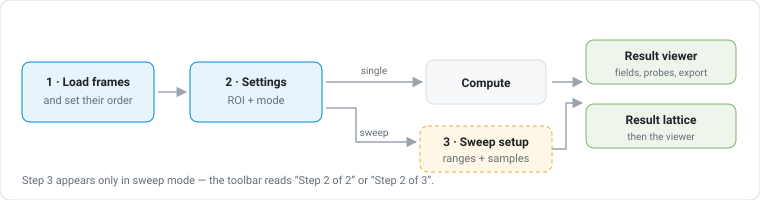

### Step 1 — Load frames

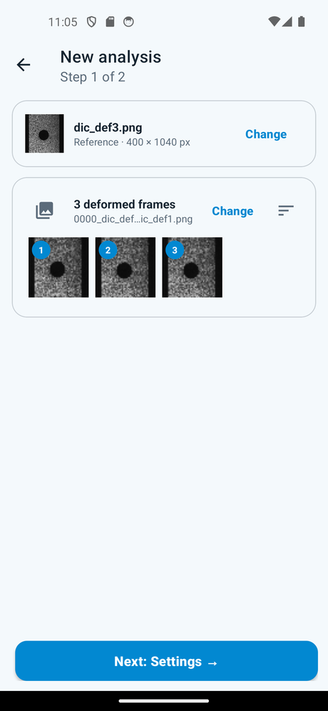

Tap each dropzone and pick your images:

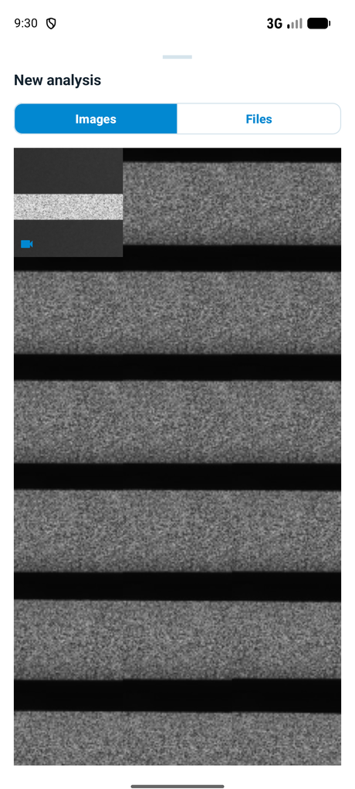

The **New analysis** sheet opens full height on an **Images** tab — your device's
gallery, three columns, with videos badged so you can tell them apart. For about
1 second the grid is dimmed behind a large centred hint so you read "Select
the reference image" before tiles unlock. Tapping the **Files** tab hands you to the
system file browser instead; that is still the only route to RAW and DNG. Picking
deformed frames is multi-select: tap the tiles you want and confirm with
**Use N**. Select-all lives in the three-dot menu.

The sheet asks for media permission the first time the Images tab needs it:

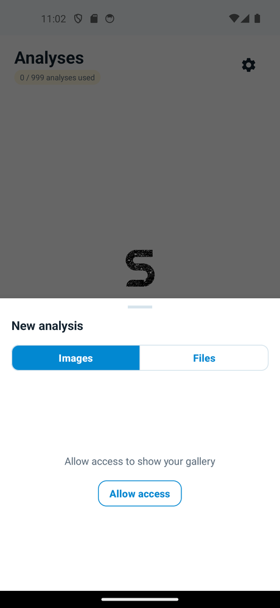

The Files tab needs no permission at all, so a phone that denies gallery access
can still work entirely through Files — it opens the system file browser:

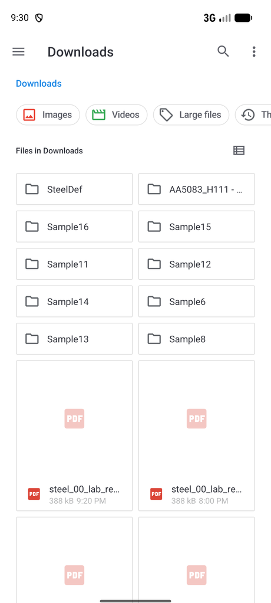

The strip shows the deformed frames with order badges.

**The app measures your speckle as soon as the reference loads.** It
autocorrelates a window of the reference and reports the average speckle
diameter. If that falls outside the 3–9 px band the iDICs Good Practices Guide
asks for, a warning chip appears under the dropzones saying what it measured and
what it means:

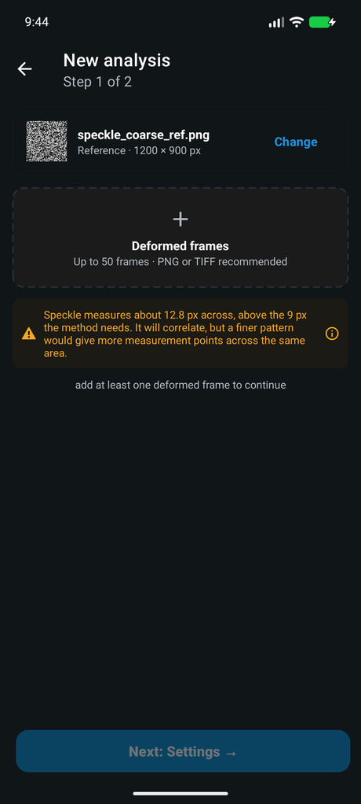

The chip is advice, not a block — the run proceeds either way. Under 3 px the
pattern is finer than the method can resolve and no subset size fixes it; over
9 px it will correlate, but a finer pattern would give more measurement points
across the same area. Either way the fix is a different photograph, which is
why the chip sits here with the images.

A separate chip appears **on step 2, under the subset slider**, when the speckle
is inside the band but the subset is too small to span three of them. It names
the subset that would, and it clears as you move the slider past it — the
control and the warning are on the same screen on purpose:

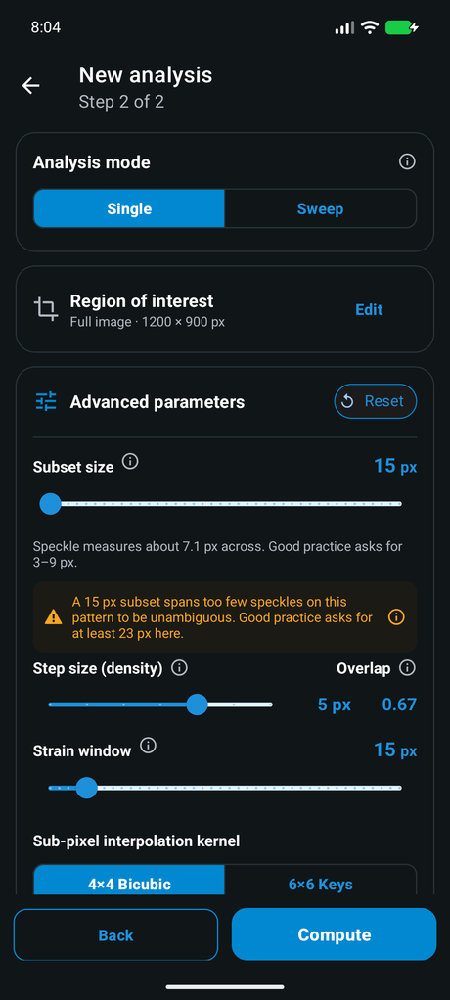

**The badge order is the analysis order.** Frame 1 here is frame 1 everywhere
after. Tap the sort icon to change it:

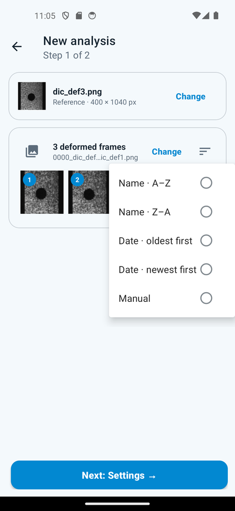

| Sort | Use when |
|---|---|
| A–Z / Z–A | Filenames carry the sequence |
| Oldest first / Newest first | Filenames don't; uses capture time, then EXIF |
| Manual | Neither works — drag the thumbnails |

You cannot get back to the picker's original order once sorted. With one
deformed frame the control is hidden.

### Step 2 — Settings

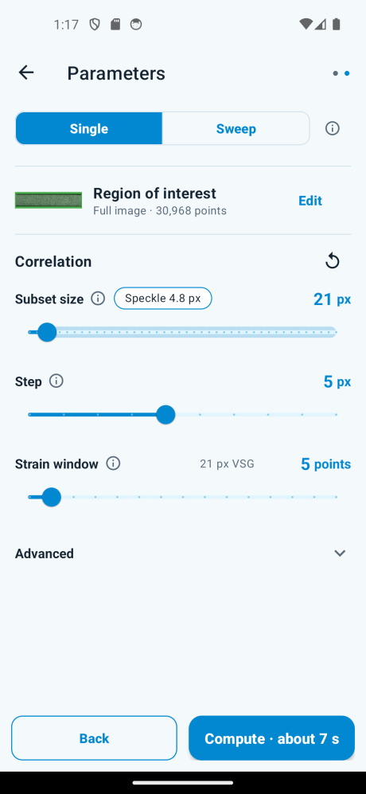

The toolbar names the page (**Parameters**, or **Sweep setup** in sweep mode)
and shows a dot per page, the current one in blue. The page is one flat list,
top to bottom:

- **Single** or **Sweep** — Single solves every frame once. A parameter sweep
  solves one frame many times ([§7](#7-parameter-sweeps)).
- **Region of interest** — a thumbnail of the reference with the region drawn on
  it, and the points the engine solves in it at the current step: "Full image ·
  30,968 points", or "1100 × 800 px · 8,800 points" once you draw one. The count
  follows the step and the region. In Sweep the row names the region alone:
  each combination solves at its own step. **Edit** opens the editor
  ([§6](#6-region-of-interest)).
- **Correlation** (Single) — subset size, step and strain window, then a closed
  **Advanced** section with overlap and interpolation ([§5](#5-parameters)),
  with **Reset** at the right of the heading. If you copied a set of parameters
  from a sweep lattice, a paste icon sits beside Reset and fills subset, step
  and strain window in one tap; when that changes the overlap, Advanced opens
  to show it.
- **Frame to sweep** and **Planned lattice** (Sweep) — in place of Correlation;
  see [§7](#7-parameter-sweeps).

Once this phone has finished a run, **Compute** reads "Compute · about 1 min":
a running mean of the points per second your own runs reached, never a guess.
Before that it reads **Compute**. In Sweep the button is **Next**, to the
sweep settings. Switching between Single and Sweep clears the last run's
status line.

### While it runs

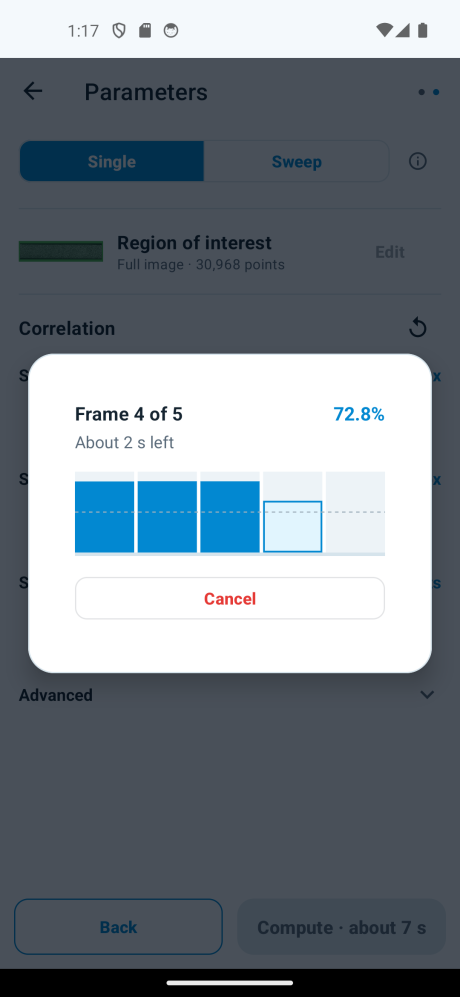

A sheet docks at the bottom of the screen, over a light shade that keeps the
wizard readable above it (it still takes every touch). Its header reads *Frame
23 of 40* with the whole run's percentage at its end; under it, the reference
you picked and the time left, *steel_00 · About 2 s left* (once a few seconds
of progress give a steady rate). Under that, one bin per planned frame shows
**convergence per frame** on a scale labelled 100 and 50: a finished frame is a
blue bar as tall as its convergence, red under the dashed line at 50%; the frame
being solved is a pale outlined bar rising with its progress; frames still to
come are empty slots. A short run's bins stay narrow, grouped in the middle,
and up to 12 frames each finished bar carries its convergence above it (red
under 50) and the running one its progress. Over 100 frames, neighbouring frames
share a bin that shows the lowest of them, so a low frame is never hidden. Once
every frame is solved the header reads *Completed 40 of 40 frames · saving*
while the run writes the analysis. After one low frame an amber line warns that
one more stops the run.

When every frame solves, the sheet holds for a moment with a green check, *40
frames solved* and *7 s · lowest 94% converged*, then the results open. A run
that stops early, fails or is cancelled goes on at once.
**Cancel** asks first (*Cancel analysis?*), then stops the run
where it is, within a moment — it does not wait out the frame being solved.
Nothing from the run is kept: not the frames it solved, not a row on Home, not
a backup, and it does not count towards your analyses. A run never touches an
analysis you already have, so cancelling one leaves those exactly as they
were. Back asks the same question. Cancelling a parameter sweep abandons the whole sweep, not
just the combination in flight, and saves none of it.

The same sheet covers importing frames (*Importing photos*) and extracting video
(*Extracting frames*), but there it shows a progress bar and counts frames
instead: the convergence bins are hidden, because nothing is being solved yet. A
parameter sweep's header reads *Analysis 7 of 9* with the percentage, then the
time left, and its planned lattice takes the bins' place, labelled only at the
ends of its ranges (the smallest and largest VSG at the left, the smallest and
largest subset under it): every combination starts as a grey ring, fills when it
solves, turns into a red ring if it is skipped, and the one being solved is
circled. Under it, *Subset 25 · window 41 px* names that combination, and once
one has ended a second line says how it went, *Last: 96% converged · 30,968
points*, or *Last: skipped* in red; at the end the header reads *Solved 9 of 9
analyses · saving*. Cancelling an import asks for confirmation and leaves nothing behind.

**A run stops itself if the images decorrelate.** Two consecutive frames below
50% convergence end it — the frames after them would be no better. The
message's title names the frame it gave up on ("Stopped at frame 40"), its text
says how many frames were kept and why, and **Why?** adds the image's name and
the longer explanation.

This is a **short run, not a failed one**: the frames solved before the collapse
are real data, they are saved as an analysis, and acknowledging the message takes
you straight into them. A 50-frame test that decorrelated at frame 40 still gives
you frames 1–39.

**The reason is kept with the analysis.** Its Home row reads "39 of 50 frames"
followed by why it stopped, and **Settings used** (the ⓘ in the viewer) lists
*Stopped early* and *Frames solved*. You do not have to remember the run — or
have been the person who made it.

**Keep the app open.** A run has no resume. If Android kills the app, the run is
gone.

### After

| Result | You land on |
|---|---|
| Single setting | Result viewer, frame 1 |
| Run stopped early | The *Stopped at frame N* message, then the result viewer from **View results** |
| Parameter sweep | Result lattice |
| Some sweep points failed | `N of M skipped` toast, then the lattice |
| Engine failed | A dialog naming the cause, and which frame and image it failed on; you stay in the wizard |
| Every sweep combination failed | The lattice, every node hollow — tap one for its reason. **View** and **Save graph** are disabled |

**A finished analysis is done.** Once its results open, the wizard closes:
**Back** from the result viewer (or the lattice) goes to Home, not back into
the wizard, and **New analysis** starts empty. A run never changes an analysis
you already have; every run that saves is a new analysis on Home, which counts
towards your quota and gets a name of its own (*steel_00 (2)* when the first
*steel_00* is still there). To try other settings on the same photos, use
**Re-run** on Home (§10).

---

## 5. Parameters

Single mode only. Slider or typed field, each with an ⓘ. Overlap and
interpolation sit under **Advanced**, closed until you tap it (the chevron
turns); the overlap is a typed field, and it follows the step.

| Parameter | Range | Reset to |
|---|---|---|
| Subset size | 15–121, odd | Recommended |
| Step size | 1–`min(30, subset/2)` | 5 |
| Subset overlap | 0.50–0.99 (`1 − step / subset`) | Follows step |
| Strain window | 3–31 points, odd | 5 |
| Interpolation | 4×4 bicubic / 6×6 Keys | 4×4 bicubic |

### Subset and step

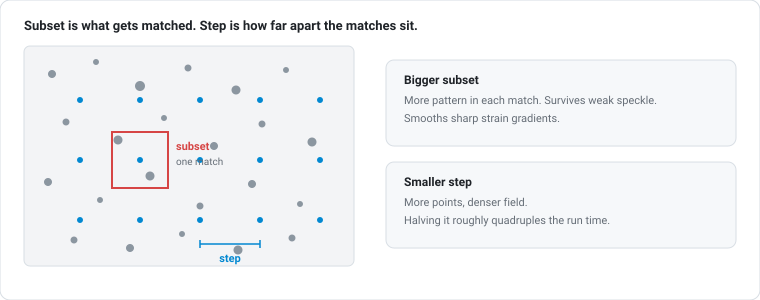

The app recommends a subset from **your** reference image, using the SSSIG model
of Pan et al. (Opt. Express 16(10), 2008): displacement error scales as
1/√SSSIG, so it grows the subset until the gradient content clears the threshold
for 0.007 px accuracy, sampled on a 4×4 grid and taken as the median.

It is a starting point. Touch the slider and it stops tracking the image.
**Reset** brings it back.

While the speckle is measured (past about a third of a second) the chip beside
**Subset size** reads **Measuring speckle…**. When it lands:

- A chip beside **Subset size** reads **Speckle 4.3 px** — the same measurement
  as the step 1 chip, in amber when it is outside the 3–9 px good-practice band.
  TalkBack reads the band out with it.
- The slider slides to the recommended size (it jumps when animations are off).
- A blue band is shaded behind the slider track from the smallest size that both
  clears the SSSIG threshold and spans three speckles, up to the slider's end.
  Larger subsets still correlate; they only blur the field more. The subset's ⓘ
  says what the band means.

They update as the reference changes, and go if the reference is removed or the
measurement fails. Below them, a warning chip appears if the subset you are on
cannot span three speckles, and names the size that would; it clears as soon as
the slider passes that size. The ROI row counts the points the region holds at
the current step ("Full image · 30,968 points").

On a pattern coarser than about 40 px no allowed subset spans three dots, so no
size is named — the over-resolved chip on step 1 is the honest answer there, and
raising the slider to its maximum would not fix it.

**Subset overlap** is how much neighbouring windows cover each other after a
step: `overlap = 1 − step / subset`. The two controls stay in sync. The iDICs
Good Practices Guide keeps overlap at least 0.5 and strictly below 1.0;
typical values are about 0.50–0.75.

### Strain window and VSG

The strain window is a count of data points. Beside its value, muted text shows
the VSG it gives at the current step — "41 px VSG" — and follows as you change
either. Sessions from
before the window was counted in points show their VSG alone.

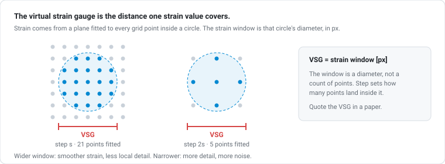

```
VSG = (strain window − 1) × step + 1     [px]
```

Quote the VSG, not the window: it is the distance one strain value actually
covers. The sweep varies the **window** and reports the resulting VSG per node —
the window is the knob, the VSG is the number you publish.

### Interpolation

Sub-pixel interpolation, a dropdown under **Advanced**. Leave it on 4×4
bicubic unless interpolation bias is your subject.

### Max frames

In Settings, not here. 10–500, default 50. Caps frames per analysis.

---

## 6. Region of interest

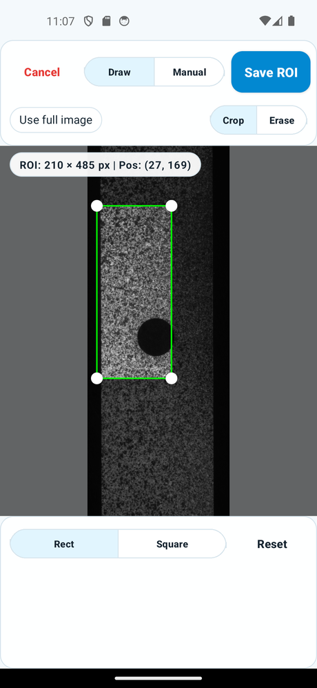

**Draw** — pick Rect or Square, drag on the image. Drag inside to move, corners
to resize. The HUD gives size and position live.

**Zoom** — pinch to zoom (up to 10×) and pan with two fingers; double-tap for
2× and back to fit. One finger always draws, so edges can be placed finer zoomed in.

**Manual** — type X, Y, W, H and Apply.

**Crop / Erase** — Crop sets the area to correlate. Erase punches holes in it,
for grips, fiducials or anything that will decorrelate. Add as many as you need.

| Button | Does |
|---|---|
| **Save ROI** | Keeps it, returns to step 2 |
| **Use full image** | Saves the whole frame |
| **Reset** | Clears the canvas |
| **Cancel** | Discards — back to full image |

An ROI smaller than the subset will not run.

---

## 7. Parameter sweeps

### Why

Strain is a derivative, so its size depends on how much you smooth. Small VSG:
peak strain rises, noise rises. Large VSG: peak gets flattened. A sweep shows
where your answer stops depending on the setting — the convergence argument the
Good Practices Guide asks for (Tip 5.4).

A sweep uses **one** deformed frame.

### Setting it up (step 2, then step 3)

Step 2 (**Sweep setup**) picks what is swept and shows the plan:

- **Frame to sweep** — a field with the picked frame's name and "23 / 40" at its
  end, a thumbnail before it and an ⓘ after it. It starts on the middle frame.
  Tap the field to open the frame picker: a scrolling list of the frames, a
  frame-number field, and a preview of the frame you are on; **OK** makes it the
  swept frame. Tap the thumbnail to see the frame large over the dimmed page;
  tap anywhere to close it. The ⓘ says which frame to pick: the one with the
  most deformation, since the sweep solves only that one. With a single
  deformed frame there is nothing to pick and the row is hidden.
- **Planned lattice** — one node per analysis, subset across and VSG up, with
  the count beside the heading ("9 runs"). The gear on its heading shows **No.
  of subsets** and **No. of strain windows**, the samples per range.

Step 3 (**Sweep settings**) sets the ranges. The lattice on step 2 follows any
change, so **Back** shows the new plan:

- **Subset** and **Strain window**, the ranges; the latter's title row ends
  with "15–101 px VSG", the span of VSGs the plan covers.
- **Step size** as subset ÷ N, and under a closed **Advanced** the overlap that
  gives.
- **Line cut axis** — **X** or **Y**, over a strip preview of the
  reference with the region and the cut through its centre. Tap the strip to
  open it larger, in the reference's own shape; a wide reference then runs past
  the screen edge and scrolls sideways. Tap again to close it.

The run button reads "Run 9", and "Run 9 · 33 s" once this phone has finished
a run (TalkBack reads "Run 9 analyses, about 33 seconds"): each analysis solves
the one frame at its own step, timed at the points per second your runs
reached.

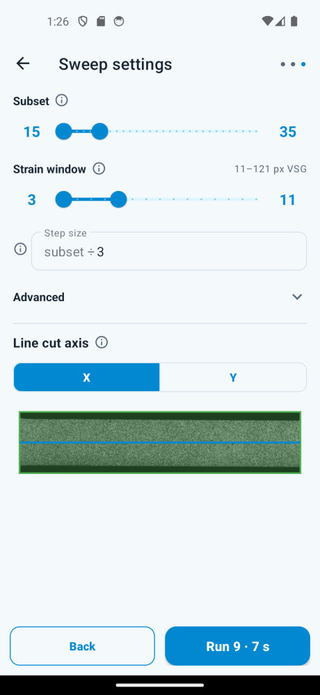

| Control | Range |
|---|---|
| Frame to sweep | list + number + preview, opened from the field (step 2) |
| Subset range | 15–121, odd (step 3) |
| Strain window range | 3–31 points, odd, default 3–11 — min and max (step 3) |
| Samples | 1–8 per axis (step 2, lattice gear) |
| Step size | subset ÷ N, N 2–9, default 3. The overlap under **Advanced** is `1 − 1/N`. Pixel step is `round(subset / N)` (step 3) |
| Line cut axis | X / Y (step 3) |

Runtime is the product of the two sample counts. 8 × 8 is 64 solves. Start at
3 × 3.

The sweep varies the **strain window** directly, not the VSG. VSG is still what
you quote — it is shown per node and in the settings sheet — but it is derived
(`(window − 1) × step + 1`), so two combinations with different steps can share a
window and land on different VSGs. The lattice plots each node at its VSG, so one
window sits higher at a larger subset's step.

The lattice preview on this step is **inert** — taps do nothing until it has
run. A first-run tip points it out.

### Reading the result lattice

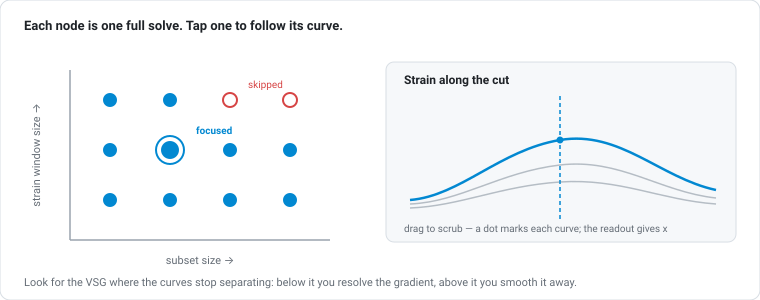

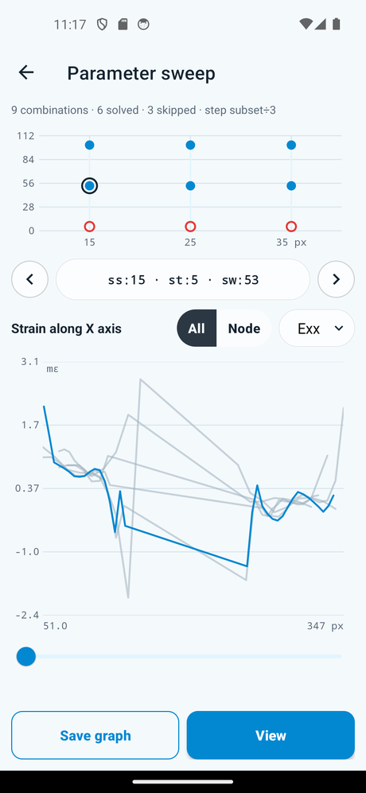

| | |
|---|---|
| Filled dot | Solved. All solved nodes share one colour; the focused one gains a ring |
| Hollow red ring | Skipped — tap it and the reason names the combination and what went wrong |

Colour on the plot below is reserved for the focused curve, so only one hue
ever carries meaning at a time.

The screen is built to be worked with one thumb. It scrolls — summary line,
lattice, controls, then plot — while **Save graph** and **View** stay pinned at
the bottom. The x axis is the **subset size** and the y axis the **VSG (px)**;
the lattice draws compact, with tick numbers and a "px" unit but no axis titles.

**Choosing a combination**

- **Tap** a node, or use the **‹ · ›** stepper above the plot to walk the solved
  nodes in order. The chip between the arrows names the current one.
- **Double-tap** or **long-press** a node — opens that result. So does **View**.
- Tapping a hollow node explains why that combination was skipped.

**Reading the plot**

- The **All / Node** pill above the plot chooses how much is drawn. **All** is
  the default: every combination, the focused one at full strength in colour and
  the rest sharing one muted neutral. **Node** narrows it to the focused
  combination alone.
- **Drag across the plot** — a guide follows your finger, a dot marks the curve
  and the value is printed beside it. The **slider** under the plot does the same
  thing and stays in sync with the drag, which is easier one-handed.
- The readout under the plot shows `x=…  y=…` for one unmuted curve, or `x=…`
  plus each `label=value` when **All** is showing several series.
- **Pinch to zoom**, **two-finger drag** to pan, **double-tap** to reset. The
  zoom survives stepping to another node; changing component resets it, because
  Exx, Eyy and Exy differ in magnitude.
- The **Exx / Eyy / Exy** selector switches component.

**Taking the answer with you**

- **Double-tap or long-press the parameter chip** to copy that combination's
  subset, step and strain window. Start a new single-setting analysis and a **Paste params** chip on
  step 2 fills them in — this is how you go from "the sweep says 41 · 5 · 15" to
  running the whole batch at it.
- **Save graph** writes a PNG and hands it straight to the system share sheet —
  it is the one export that does not go through **Send to**. The file carries a
  header naming the study, the reference image and deformed count, and the
  focused combination's parameters (plus the combination count when the plot is
  showing **All**); the plot; and a single-column colour legend. It is rendered fit-to-data, so your
  on-screen zoom neither leaks into the file nor is disturbed by saving.

Look for the VSG where the curves stop separating.

---

## 8. Reading results

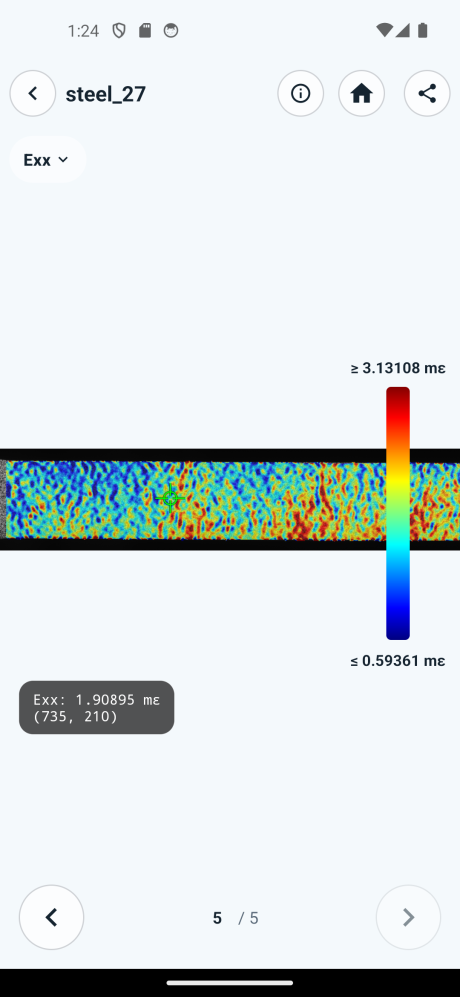

**Opening.** If the first frame takes longer than about a third of a second to
appear, a small pill in the middle reads **Opening steel_00 · 40 frames** (the
reference's name and the frame count) until that frame draws.

**Back** goes to Home, whether you opened the result from Home or it opened
when a run finished; from a sweep's lattice, Back from a combination returns to
the lattice, and Back from the lattice to Home.

The field button (top left) switches field. Pinch to zoom (~10×), drag to pan; both survive a
field change. Double-tap zooms or resets. A horizontal fling while fit-to-screen
steps frames. Chrome auto-hides after a short idle; pan or scrub brings it back,
and so does a tap in the middle of the screen or a downward swipe. The figure
itself runs edge to edge, under the system bars. The ⓘ sheet holds the specimen
name, max / min (with coordinates), mean, a histogram of this frame's accepted
values, and the settings used for this analysis. The looping summary has no
mean and no histogram — its ⓘ sheet quotes only the GIF colour-bar ends.

**Colour scale.** Default on a **single frame** is a **clamp at this frame's 2nd and 98th percentiles**,
which is why the hairline reads "≤" and "≥" rather than "Min"/"Max" — a handful of
outliers must not flatten the whole map. On a single frame the ⓘ sheet still
gives you the true extrema, and the two are allowed to disagree. While the
summary animation is up, the colour bar and ⓘ both quote the **lowest scale-min
and highest scale-max across every frame** — those two ends need not come from
the same frame. Tap the bar to set fixed min/max
(remembered per field). **Auto** drops a custom override and returns to the
clamped bounds on a frame, or to that sequence envelope on the summary. On a single-setting analysis the
summary GIF and share field GIFs still use a whole-sequence scale so the
loop stays comparable.

**Tap to probe.** There is no Inspect / X,Y / Max-Min row. A short tap on the
heatmap — including the centre — places a crosshair and a plain-text reading at
the nearest correlated point. The bars hide on an idle timer, not from a tap;
a centre double-tap brings them back when they have faded. Drag past the touch
slop pans (or flings to the next frame when unzoomed); pinch still zooms. Tap
the readout chip to dismiss. Switching field or frame keeps the probe at the
same image location and updates the value.

**The summary comes first** on a single-setting analysis. The viewer opens on a
looping field overview of the whole sequence — every frame, never longer than
10 seconds, about 300 ms a frame until the frame count forces it faster. It is
framed on the same coloured region the live view rest-fits to (your ROI, or the
accepted points), scaled to fill — not a letterboxed full photo. While it builds
a pill above the frame scrubber says how far it has got ("Reading frames · 2 of 5",
then "Building summary · 3 of 5") over a thin bar, with a **✕** that cancels; it
stays up when the other controls fade. Until the sequence range is known the colour
scale's ends read "—". **Next** enters the
frames; **Prev** on frame 1 comes back to it. Switching field rebuilds it in that
field. The field button stays available while it plays. A parameter sweep opens from
the lattice onto one combination instead; there is no overview slot.

**Frames.** Prev / Next step through. The title at the top names what is on
screen — *Summary*, the frame's file name without its extension, or a video
frame's time in its clip (`0:01.25`) — and the
field button beside it names the field. Between the arrows, a frame shows
`i / N`, and the summary `5 frames`. Tap the frame number, type another and
press Go to jump straight to that frame — useful at 150 frames.
Anything out of range leaves you where you are. On a sweep each frame is a
parameter combination, titled like `Subset 15 · window 3` (the strain window in
data points; the step is always the subset divided by the sweep's N).

### Settings used

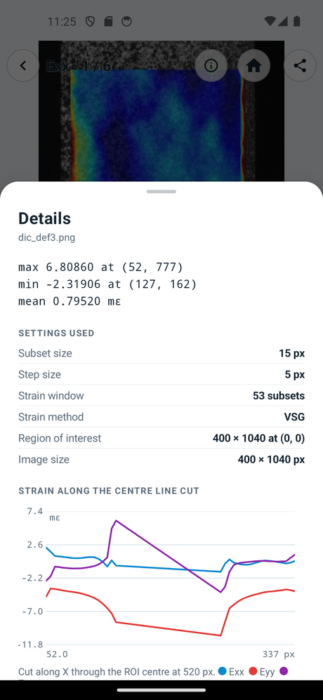

The ⓘ button. On a still frame: true min, max and mean, then a histogram of
every accepted point (including values the colour bar has clamped away). Tap a
bar for that bin's range and count. On the summary GIF the histogram is omitted.
Then everything the result was computed with — and on a sweep, the
line-cut plot. The strain-window row gives both numbers, e.g. "13-point window ·
VSG 61 px", `(13 − 1) × 5 + 1` (the relation is in [§5](#5-parameters)). A session
from before the window was counted in points shows "VSG 15 px" alone. **Reference** says which
image each frame was solved against, in the words of the Advanced → Reference choice
("First image", "Every frame", "Every 2 frames"). A run that stopped early also
carries **Stopped early** and **Frames solved** here.

**Record integrity** checks the results against the signed record the analysis wrote
beside them (ADR-028): **Verified** (every result file is as the analysis wrote it, and
this phone's own key signed it), **Signed on another device** (the files match a
signature by some other key: a restore on another phone, an analysis from before a
reinstall, or a re-signed forgery; this phone cannot tell which, so it is not a pass and
the key has to be checked against the account's registered devices), **Changed since analysis** (a file was
edited, removed or added; an amber note names them), **Not signed** (the record has no
signature, so it cannot rule out an edit) or **Not recorded** (an analysis from before
records existed). The report's cover prints the same as **Record Fingerprint**.

**Changing settings later never changes an old result.** This sheet is your
provenance record.

---

## 9. Exports

**Share** gives six targets, one line each: a title and, at the end, the file type
(**This field** PNG, **All fields** 5 PNG, **Animations** 5 GIF, **Report** PDF,
**Data** CSV, **Everything** ZIP). The header names the frame the photos come from
("frame 2 of 5"; "combination 2 of 5" on a sweep). With TalkBack, each row says
what it shares. Each ends at a **Send to** sheet with two rows:
**Save to Files** (a folder picker, so it lands somewhere you choose and stays) or
**Share** (the usual system chooser). For everything but the single photo the
sheet comes up **first**, so the file is written straight into the folder you
picked instead of being staged and handed over. Exports are named after the
analysis, so a folder of them is still readable a month later. While an export
runs, its progress dialog says what it is on ("Frame 12 of 40 · heatmaps"), the
percent to one decimal ("34.6%") and, after a few seconds, "About 35 s left". A long
export does not hold the screen: dismiss the progress dialog and it carries on behind
a strip at the top, with the same progress and a Cancel.

| Export | Contents |
|---|---|
| This field | One PNG: current field and frame, annotated, composited to a 1280 px long edge |
| All fields | Five PNGs for this frame, zipped; each stamp names the source image |
| Animations | Single-setting only: five looping field GIFs on one whole-sequence scale, zipped |
| Report | One PDF: every frame, plus a telemetry page |
| Data | One CSV: `image,x_px,y_px,u_px,v_px,exx,eyy,exy,znssd` — a sweep adds `subset_px, step_px, strain_window, vsg_px` |
| Everything | One ZIP: raw photos + all fields + CSV + PDF; single-setting also includes the field GIFs |

On a single-setting analysis the field GIFs are shared as a set, not one at a
time — they are only comparable because they share a scale, and the set is what
carries that.

Build on the **CSV**. Coordinates are image pixels, displacements pixels,
strains scientific notation. `znssd` is the match residual — filter on it to drop
badly correlated points. Number formatting is locale-independent.

For a paper, export **Everything** and keep it with your raw images. Inputs,
fields and parameters in one archive is what makes the result reproducible.

---

## 10. Managing analyses

Long-press a row to select. Pencil renames (one row only), bin deletes. When
every selected row is **Only in cloud**, a cloud-download button restores them
all at once; each row shows its own progress.

**Re-run** (the circular arrow, one row only) starts a **new** analysis from the
selected one: the wizard opens on **Parameters** (or the sweep's settings page
for a parameter sweep) with a copy of the same reference photo, the same frames
in the same order (a video's frames keep their times and clip name), the same
ROI and mask, and every setting as it was run. Change what you want and tap
**Compute**; the analysis you started from is never changed. The new one counts
towards your analyses like any other and is named after the reference, with
*(2)* added while the first is still on Home. A parameter sweep keeps only the
one frame it was solved against, so its Re-run has that frame alone. Re-run
needs the original photos on this phone: an **Only in cloud** row asks you to
restore it first, and a freed-up one says this phone doesn't have them.
In Semper Classroom, Re-run copies the test too: a **Tensile** or **Bending**
analysis comes back as one, with its cross-section or beam dimensions, its
strain axis, its beam-edge taps (and the deflection scale and bias set in
Results), and bending's typed hanger masses. A machine's load log is not kept
with the analysis, so a test that read one opens on step 1 and asks for the
log again; import the same file and continue. A tensile analysis's own scale
and bias (**Adjust curve**) are set again in Results after the run.

An analysis made before Re-run kept its reference, or restored from the cloud
(the backup does not carry Re-run's copy), asks you to **Pick its reference
photo**: choose the same photo again, and its frames and settings come from the
analysis. The photo must be the analysis's size; another says "This photo is
W × H; the analysis used W × H." and lets you choose again or cancel. Such an
analysis kept only its region's rectangle, so a region you drew comes back as
that rectangle, and the app says once "The mask wasn't saved; the region is a
rectangle." Redraw the shape on the ROI step if it was not a rectangle.

**Backups that are not on this phone.** On a new phone, or after a reinstall,
Home shows a card above the list — "4 analyses in your cloud backup aren't on
this phone." **Restore** lists them, all ticked; untick any you don't want and
they restore in the background. **Hide** puts the card away until the account
gets a backup this phone has not seen; hidden backups stay in the cloud and
Settings → Analyses data management can still restore them. Demo accounts have
no cloud backup, so they never see the card.

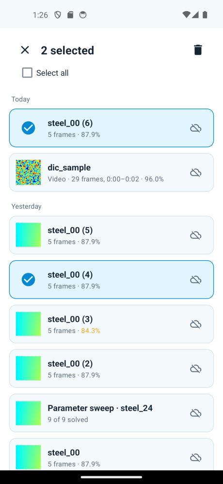

**What delete does depends on whether there is a cloud copy.** With none, it
goes from the phone and that is that:

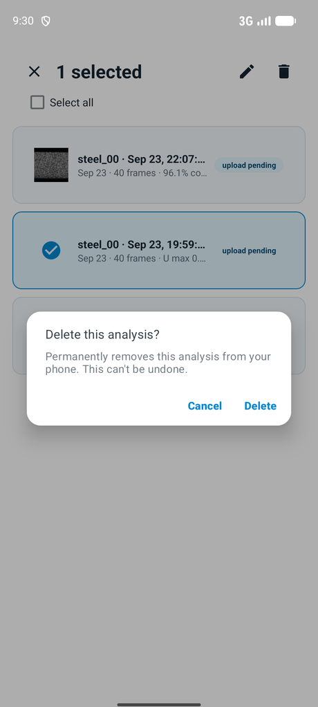

With a backup you are asked *where* instead — **From this phone** (the cloud
copy stays), **From the cloud** (the phone's copy stays), or **Everywhere**. A
deleted cloud copy cannot be recovered, so read that dialog before tapping.

**Deleting on this device only is not losing it.** The row stays on Home, marked
**Only in cloud**, and tapping it offers to **Restore** the analysis to the phone.
It restores in the background, and you stay on Home. That is the point of the mark: a cloud-backed analysis is one tap
from being local again, so freeing space is a reversible decision.

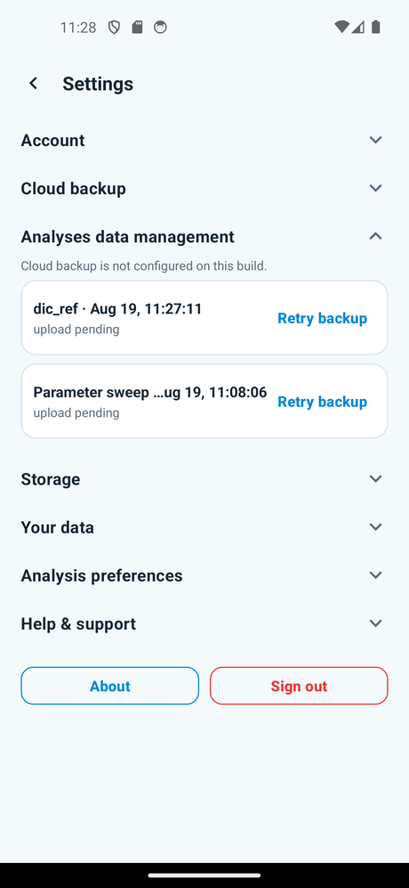

**Cloud backup**: turn **Save to cloud** on and it offers to back up what is
already local; off, new analyses stay on the phone and existing cloud copies
remain. **Wi-Fi only** holds uploads until Wi-Fi. The line under the switches
says whether everything is backed up, or how many analyses are not. On a demo
account this section, **Analyses data management** and Storage's Free-up controls
are shown locked, with the licence note (Appendix D). **Analyses data management**
lists local and cloud together, with three actions per row:

| Action | Does | Shows when |
|---|---|---|
| **Download** | Saves a `Session.zip` to a folder you pick — you choose the destination *before* it starts, and the bytes go straight there | Any row with a cloud copy, including ones already on the phone |
| **Restore** | Pulls the analysis back into the app so it opens normally | Only when the local frames are missing |
| **Delete** | Removes the backup, with a **5-second Undo** | Any row with a backup |

Downloads and restores keep running if you leave Settings, and report back when
they land.

**Storage** is the section to reach for when the phone fills up. It measures what
the analyses and the temporary files actually occupy, and gives you three tools:

| Control | Does |
|---|---|
| **Free up N MB** | Drops the local frames of analyses that are already backed up, N being what that frees. They become "Only in cloud" rows; nothing un-backed-up is touched. It shows only when there is something to free |
| **Clear** | At the end of the **Temporary files** row: removes regenerable files — import leftovers, transfer scratch, exports waiting to be shared. Gone when there is nothing to clear |
| **Auto-free space** | A slider, 0 (Off) to 64 GB, its value beside the title ("Over 8 GB"); the ⓘ explains it. Set it and the app reclaims space at start-up whenever usage is over the budget, oldest backed-up analyses first |

**Background transfers survive leaving the screen and are honest about failure.**
An upload or restore runs even if you navigate away, showing a system
notification while it works ("4.2 of 12.0 MB · 1.1 MB/s", "34.6% · About 35 s
left"), and — while you are on Home — the row's own progress line and bar ("Backing
up · 4.2 of 12 MB"), for downloads as well as uploads. When it ends, the
notification says so ("steel_00 is backed up"), or gives the reason it failed with
**Retry** for a backup or a restore, and the row's cloud icon updates. From
Android 13 on those end-of-transfer notifications appear only once you allow
Semper's notifications in the system settings. A backup that *fails for good*
(another device holds the account, the analysis is too large, or a render ran out
of memory) turns the icon red; tap it for a dialog explaining why, with **Try
again**. A restore that fails (the backup
was deleted, or is not this account's) says so once, on whichever of Home or
Settings you are on. You are no longer left guessing.

**Your data** also holds **Send crash reports**. That one switch governs both
crash diagnostics and anonymous product analytics — which screens and actions get
used, in coarse buckets. Neither carries your images, results, specimen names or
addresses, and nothing is sent until you turn it on.

**Your data** holds the two exports and the account delete. **Export my data**
builds a ZIP of everything on this phone; **Download cloud data** asks
the server for its copy. Both show progress and finish at the same **Send to**
sheet as any other export.

**Delete account** (Settings → Your data) asks you to confirm your
identity first, on the sign-in screen itself — whichever way you normally sign
in: password, Google, or an emailed link. Your address is filled in and cannot be
changed; you are proving *this* account. Back out and nothing happens. Once
confirmed it erases the cloud copy, this device, and the sign-in itself, and
signs you out. If the cloud cannot be reached nothing is deleted at all. A
licence goes back first: an institution seat is freed for someone else, and an
individual licence is released and re-offered to the same address, so signing
up again with it is licensed straight away.

**Quota.** From 80% of the cap, a chip under the Home title reads
`N / M analyses used`; it turns red at the cap. Below 80% it is hidden.
Every run is checked against it, since every run that saves makes a new
analysis (Re-run included); a run already under way when the cap fills still
saves.
Not a paywall: the limit screen asks for nothing. Delete an analysis and tap
**Re-check**, or, if a seat or licence has just been added, tap **Refresh
licence**. **Email support** opens a plain mail with the account details
underneath. On demo the cap also counts every account's analyses stored from
this phone.

**Help & support** is the last section, and it now opens the **Manual** directly
as well. **Send feedback** is for "this could be better" — it opens a mail with
your app version and phone model and nothing else. Prefer the
[Manual](https://sempermechanics.com/manual/) for how-to. Report bugs and
request features from **Settings → Help & support** (opens the Support page).
The section also shows
`support@sempermechanics.com` — selectable, so you can copy it if this device has no
mail app — and **Email support**, which opens a mail already carrying your
account, device ID, app version and phone model for private or account issues.
Write above that block; leave it in place.

---

## 11. Troubleshooting

| Symptom | Cause |
|---|---|
| Run blocked, size message | A frame differs in pixel size from the reference |
| **Next** off on step 1 | Missing the reference or all deformed frames |
| "ROI too small" | ROI smaller than the subset — enlarge it or shrink the subset |
| Engine failure: feature detection | The pair could not be correlated. Pattern, or wrong pair |
| Engine failure: ROI | Region too small or fully masked |
| Low-texture warning | Weak speckle for this region |
| Sweep skipped nodes | Those combinations don't fit — usually big subsets in a small ROI. Tap a hollow node for its reason |
| Run stopped itself partway | Convergence fell below 50% twice running — the pair has decorrelated. The message names the frame, and the frames before it are kept |
| Sweep ended early | Same rule: two combinations under 50% and it stops rather than sweep the rest |
| Password rejected on sign-up | 8+ chars, upper and lower case, a digit and a special character — or tap **Generate secure password** |
| Only the first N frames | *Max frames* capped it |
| Frames in the wrong order | **Re-run** it from Home, sort on step 1, then Compute |
| Run vanished | The app was killed. No resume — run it again in the foreground |
| Frames look incomparable | Auto colour scale. Fix the bounds, or on a single-setting run use the summary overview — it already puts them on one |
| Summary still says "Building summary" | A long analysis takes a while to render five fields; the frames are usable meanwhile |
| Delete account opens the sign-in screen | Expected — that is where your identity is confirmed |
| Cloud icon stuck on Upload pending | Offline, Wi-Fi-only, or backup off |
| Cloud icon crossed out in red | The backup failed. Tap the icon — the dialog names why (device conflict, too large, ran out of memory) and offers **Try again** |
| Restore never arrived | If it failed for good, Home and Settings both show a message saying so; otherwise it retries on a flaky network |
| Row says "Only in cloud" | Its local frames were freed (by you, or by the auto-free budget). Tap it and choose **Restore** |
| Phone out of space | **Settings → Storage → Free up N MB**, and consider setting an auto-free budget |
| Still pending approval | Tap **Check status** — it never polls |
| Sign-in refused after signing up | Open the verification link in your email, then try again |
| Nothing here matches | **Settings → Help & support** — [Support](https://sempermechanics.com/support/) or **Email support** (the mail carries your account, device and build) |

---

<!-- ## 12. Limits

- An interrupted run is lost. No resume.
- Background transfers notify while they run, but nothing tells you they finished.
- No spatial calibration — pixels only.
- Coach marks show once and cannot be replayed.
- Approval never polls.
- Credits & licences (Settings → Help) covers the example data and the engine's DICe, OpenCV and Eigen licences only; the AndroidX and Firebase notices are not listed yet (TD-57).
- ROI shapes are rectangle and square only. -->

---

## 12. Lab tests

**+** asks which test it is: **2D DIC**, **Tensile** or **Bending**. That choice decides what the wizard asks for, and you make it once per analysis. **2D DIC** is everything in §1–§11; the two tests add what follows.

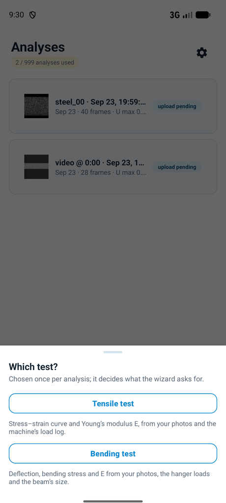

Formulas, accuracy and worked numbers: [app/STUDENT_LAB_WORKFLOW.md](app/STUDENT_LAB_WORKFLOW.md).

### Tensile: stress–strain and E

<p>
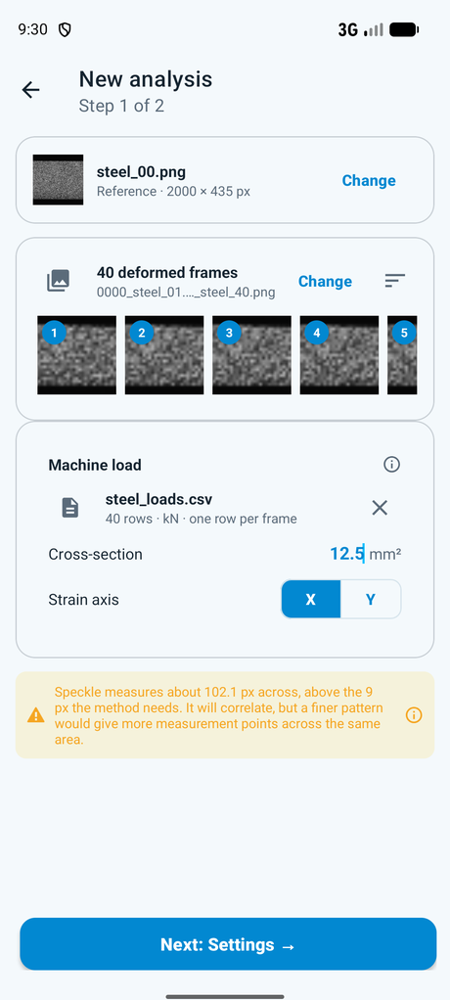
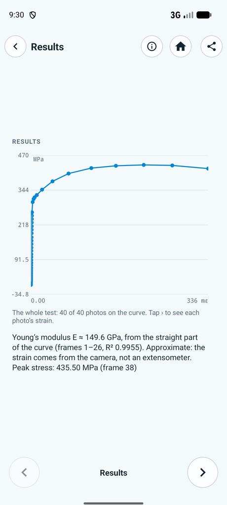
</p>

1. **Photos.** Pick the reference (no load), then the loaded photos, or a video.
2. **Load log.** The machine's CSV with one load per row, in N or kN. With photos, a log that matches the frame count is paired in order.
   With a video, or photos that carry an EXIF capture time (reference too), a timed log is matched by time: a frame takes a row within 100 ms, or has no load.
3. **Cross-section** in mm², and the **strain axis** (the pulling direction in the photo).
4. Set the ROI on the gauge section and tap **Compute** (§4).

**Results** is the first page of the viewer. It shows:
- the curve;
- **E** from the straight part (the frames used and R²);
- the peak stress.

The strain is **ΔL / L₀** from a virtual extensometer between the two ends of the analysed region, so draw the ROI over the gauge length you want. The lab report's table adds that **Extension (px)**. A photo where one end has left the view has no strain and is not on the curve.

### Bending: load–deflection and E

<p>
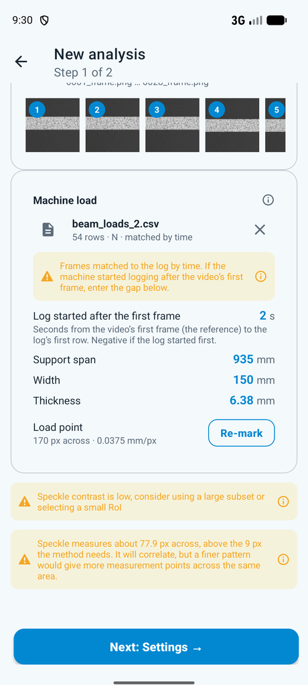
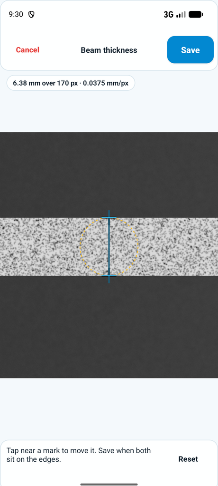
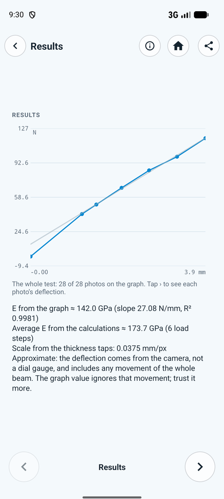
</p>

1. **Video** of the beam's side face at mid-span, filmed from a tripod. Extract on **Interval** at 1 fps, or take its **Keyframes** (§4).
2. **Timed load log** (`time, load`). Frames are matched to it by time. If the log started later than the video,
   put the gap in **Log started after the reference**, in seconds (negative if the log started first).
   Hanger mass in kg × 9.81 = load in N.
3. **Span, width and thickness** in mm.
4. **Beam height → Set.** Double-tap to zoom, then tap the top edge and then the bottom edge right under the load.
   The readout gives mm/px. Under 40 px a 1 px slip moves E by several percent, so zoom in or film closer.
5. ROI on the beam, then **Compute** (§4).

In **Results**:
- **E from the graph** (the slope of W against δ) is the number to trust.
- The average of the per-step E includes any movement of the whole beam.
- Unloaded frames are dropped. Frames at the same hanger load become one load step.

### The lab report

**Share → Lab report** fills in the handwritten report's layout.
Blank lines are left where the app has no value, such as the final diameter, name and date.

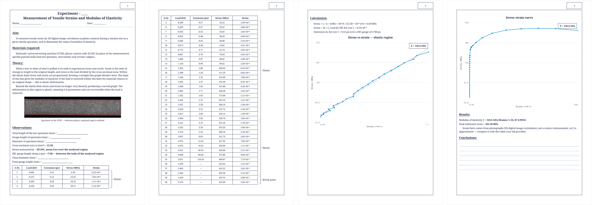

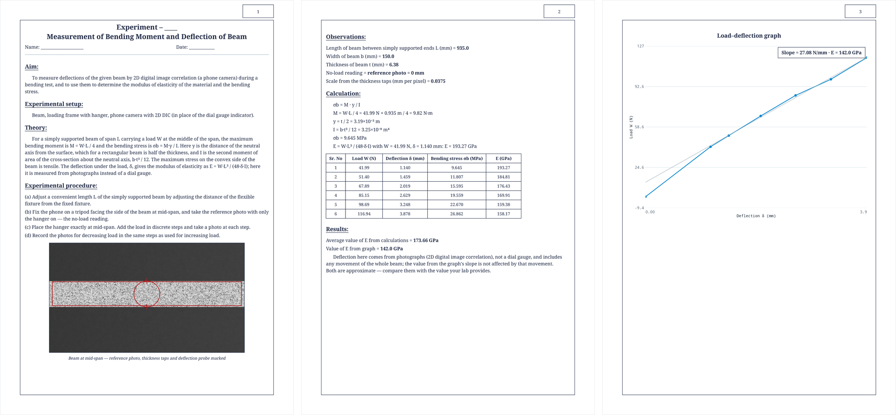

### 2D DIC: the fields only

Pick **2D DIC** when you only want the displacement and strain maps, with no load log and no specimen size.
The wizard has no load card; pick the photos, set the ROI and tap **Compute** (§4).
The analysis is saved as a plain DIC analysis: no **Results** page, no lab report, and no **Test type** row in ⓘ.

---

## Appendix A — Parameters

| Parameter | Range | Default | Raise when | Lower when |
|---|---|---|---|---|
| Subset | 15–121, odd | Recommended | Speckle is weak; correlation fails | You need resolution across a sharp gradient |
| Step | 1–30 | 5 | Runtime matters | You need a denser field |
| Strain window | 3–31 points, odd | 5 | Strain is noisy | Detail is being smoothed away |
| Interpolation | 4×4 / 6×6 | 4×4 bicubic | Studying interpolation bias | — |
| Max frames | 10–500 | 50 | Long sequences | Runs are killed for memory |
| Sweep subset range | 15–121, odd | Around recommended | — | — |
| Sweep strain window range | 3–31 points, odd | 3–11 | Strain is noisy | Detail is being smoothed away |
| Step denominator | 2–9 | — | Denser correlation | Faster runs |
| Samples | 1–8 per axis | 3 | Finer detail | Runtime is the product |

`VSG = (strain window − 1) × step + 1` (px; window in points)

## Appendix B — Glossary

| Term | Meaning here |
|---|---|
| Reference | The undeformed frame everything is matched against |
| Deformed frame | One load step |
| Subset | The pixel window matched at each point |
| Step | Spacing between grid points |
| Strain window | A count of data points (odd): strain is a plane fitted to every point within (window − 1) / 2 steps |
| VSG | Virtual strain gauge — what one strain value covers, `(window − 1) × step + 1` px |
| ROI | Region of interest, optionally with erased holes |
| SSSIG | Sum of squared subset intensity gradients — drives the subset recommendation |
| ZNSSD | Correlation residual, one per point, in the CSV |
| mε | Millistrain |
| Parameter sweep | One frame solved across a lattice of subset × VSG |

## Appendix C — Administrators

Admin accounts get **Settings → Account → Pending access requests**: everyone
waiting, with **Approve** and **Deny**. Approved users get in when they next tap
**Check status** — they are not notified, so tell them.

You do not have to watch that list. The backend emails `support@sempermechanics.com`
the moment an account is created pending, naming the account and its user id,
with both ways to approve it. One mail per account, at creation — approving,
denying or signing in again sends nothing further. If no mail arrives, check the
`NOTIFY_FROM` / `RESEND_API_KEY` settings on the service: unconfigured, the
backend sends nothing and says nothing, and the pending list is your only signal.

**Monitoring.** The production service has four Cloud Monitoring dashboards,
applied with the alerts by `scripts/apply-monitoring.sh`: `semper-service-health`
(requests, 5xx ratio, latency, instances, CPU and memory, production beside
staging), `semper-licensing` (activations, seat checkouts and device-lock drops by
outcome, app and build), `semper-security` (`AUTH_DENIED` refusals by stage, audit write
failures, revocation-check failures beside Firebase Auth admin rate limits, App
Check failures) and `semper-slo` (the 99.5 % availability SLO and its error
budget). What each chart shows and what to do when an alert fires:
[ops/monitoring/README.md](../ops/monitoring/README.md). A chart stays flat until
the backend that writes its log line is deployed, which is not the same as
healthy.

## Appendix D — Licensing (demo / individual / institution)

Every account signs in, and every account is **Demo** (25 saved analyses, no
share, no backup/restore *feature*) until the server attaches a paid
entitlement to it. A demo account's analyses are still **recorded** — images
and results upload and are stored exactly as a licensed account's are — but the
app shows demo no sync icon or banner, shows Settings' backup, Analyses data and
Free-up controls **locked**, and the backend refuses demo retrieval (`/content`,
bundle → `feature_not_licensed`). Recording is open so that installed builds
predating licensing keep backing up after the backend deploy; a licence turns
retrieval on with nothing to re-upload. The demo cap counts analyses stored at
once, per account and, for demo, per phone (every account's analyses from that
phone): deleting one frees its place.

**Nothing is entered in the app, and nothing is sold there**
([ADR-024](adr/ADR-024-account-anchored-entitlements.md)). There is no screen to
type a licence key, no price, no buy button and no link to a payment page; that
keeps the app within Google Play's rules for apps that only use what was paid
for elsewhere. A paid entitlement reaches an account one of three ways:

- a **roster seat**: an institution's IT (or Semper staff) adds the address;
- an **individual licence** minted against the address: it attaches when that
  address signs in;
- a **one-time claim code**, redeemed by the person on the web account page
  (`/account`, card **Redeem a claim code**, shown only while no licence is
  attached; it needs a verified address and a second factor). Use it for a
  reseller deal, for joining an institution by email domain, or to recover an
  invite that went wrong.

See
[CLOUD_ARCHITECTURE_GCP.md §20](backend/CLOUD_ARCHITECTURE_GCP.md#20-licensing--entitlements)
for the full design; this appendix is the day-to-day operator/support version.

**On the phone.** **Refresh licence** (Settings → Account, and on the
analysis-limit screen) asks the server for the account's licence now, rather
than at the next check (every 4 hours, sooner when the stored entitlement is
due for renewal). It answers
with one line: "Licensed (institution seat)", "Licensed (Semper licence)", "Still
on the demo", or "Couldn't reach Semper — will retry" (it then keeps trying in the
background for about 15 minutes). After a licence is attached, tell the person
to tap it. A first sign-in on a phone fetches the licence before Home opens.

A feature the licence does not include is **locked, not hidden**: Settings'
**Cloud backup**, **Analyses data management** and **Storage** Free-up / Auto-free
controls, and the viewer's **Share**, stay on screen, disabled, with the note
"Included with an institution seat or a Semper licence. Ask your institution's IT,
or contact Semper support." A tap says the same. When a kill switch or the
organisation's EMM switches backup off, those Settings sections are hidden as
before; when the `share` switch is on, Share says "Sharing is temporarily
unavailable."

**Kill switches** (`KILL_SWITCHES`, [RELEASING.md](ops/RELEASING.md) "Rollback
levers") are refused by the server, not only hidden by the app: with `upload` or
`backup` on, the server refuses new backups and their completion; with `restore`
on, restores and downloads. The refusal is `503 feature_paused`: a backup waits and
retries by itself; a restore or download stops and says restoring is paused
(not "failed"), to be started again once the switch is off. `share` has no
server side: only builds that read the switch obey it.

**Minting a key** (Semper staff, device-attested — same admin device that
approves/revokes accounts):

- **Individual**: `POST /v1/admin/licenses` with an `emailLock`. Minting also
  records a pending invite against that address, and **that is the delivery**:
  the customer signs in with it and the licence attaches on their first
  request. If that address **already has an approved, verified account** — a
  demo user, or an account from before licensing — the licence attaches
  immediately at mint time instead; the response carries `claimedByUid`, and
  the system demo key is dropped. It binds to the first device they sign in
  on, and stays on that device.
- **One licence per person.** An address that already holds or is promised a
  live licence — its own, an institution seat, or a pending invite — is
  refused with `409 email_already_licensed: <licence id>`, and the desk shows
  that licence. To renew, use Edit on it; to replace it, revoke it first, then
  mint. A revoked licence, one past its grace, and the Demo key do not count.
  The same rule refuses a claim code (`409 already_licensed`) and an
  IT roster add (`409 member_already_licensed`). To change the person's
  device, use **New device** on their licence — never a second licence.
  `backend/scripts/find_duplicate_licences.py --project <id>` lists anyone
  who got two before the rule existed. Nothing is sent to them and nothing is typed. `deviceIdLock` is
  still accepted for the rare case where the device is known up front, but
  normal issuing leaves it empty.
- **Institution**: `POST /v1/admin/licenses` with `kind: "institution"`, a
  `domainLock` (the institution's email domain), the `adminEmails` of the
  people at that institution who will manage seats, and an optional
  `maxSeats`. IT then builds the roster by address. Anyone at that institution
  with a **verified** email on the domain can also redeem the institution key as
  a claim code on the account page and take a seat, up to `maxSeats`.

**Perpetual or timed.** Either kind of key is one or the other, set by
`duration` at mint:

- `duration: "perpetual"` (the default) — never expires. Do **not** send
  `expiresAt`; the request is rejected if you do, so a perpetual key cannot
  silently acquire an expiry.
- `duration: "timed"` — requires a future `expiresAt`. Add `graceDays` to say
  how long it keeps working past that date (omitted uses the fleet default of
  14; `0` is a hard cliff).

`supportUntil` may be set on either and is recorded for support's benefit
only — it never stops anyone using the product.

**What grace means.** During grace the account keeps *everything*: cloud
backup, share, the licensed analysis ceiling. The user sees a notice on Home
saying a renewal is overdue, and nothing else changes. It exists so a renewal
being processed does not interrupt someone mid-project. Entitlement stops at
`expiresAt + graceDays`, at which point the account drops to Demo — which, as
always, never deletes anything.

**Renewing a key** (Semper staff, device-attested):

```
PATCH /v1/admin/licenses/{licenseId}
{"expiresAt": "2027-06-01T00:00:00Z", "graceDays": 30}
```

This extends the key **in place**. Everyone already on it — the individual
holder, or every non-revoked institution seat — is re-entitled without issuing
a new key or asking anyone to re-activate. Send only the fields that change;
`maxSeats`, `maxAnalyses`, `supportUntil` and `note` can be edited the same
way. A `maxSeats` below the members already on an assigned institution roster
is refused (`422 max_seats_below_used`) — it would remove nobody and only make
the count read "12 of 10"; remove members first. A floating licence's pool may
be smaller than its roster. On the desk every one of these is the row's
**Edit** dialog, which sends only what changed.

**Upgrades and downgrades in place.** On an institution licence, `seating`
switches between assigned and floating (floating needs `maxSeats`; assigned
needs `maxSeats` to cover the roster, and clears every lease), and
`adminEmails` replaces the IT contacts. `perpetual: true` removes the end
date. What you cannot change is who the key is *for*: `kind` and the
email/device/domain locks are fixed at mint — except **To institution**
(`POST /v1/admin/licenses/{licenseId}/convert` with `domainLock`,
`adminEmails`, `maxSeats`, `seating`): a new institution key carrying the
individual licence's terms, the holder moved onto its roster on the same
device, and the individual licence revoked and marked replaced. The holder's
address must be on the domain. The new key is shown once.

A new `expiresAt` must normally be **later** than the one in force. The
request is refused with `422` and nothing changes if the date has already
passed (`expiry_in_past`), is earlier than the current expiry
(`expiry_before_current`), or the key is perpetual (`license_perpetual`). A
**downgrade** agreed with the customer — an earlier end, or an end on a
perpetual key — is sent with `"allowShorten": true`; the desk asks for the key
to be typed first. A past date is refused even then: to end a key now, revoke
it. The operator desk reports the expiry the server stored.

**`maxAnalyses` is per person, not per licence**, and is normally left empty:
empty gives every holder the licensed default (`LICENSED_MAX_SESSIONS_PER_USER`,
999). On the operator desk it is "Cloud analyses per person", and the table's
"Analyses / person" column shows it. A value below the demo allowance
(`DEMO_MAX_ANALYSES`, 25) is refused, and the backend floors any older one at
that allowance. To remove a cap, empty "Cloud analyses per person" in the
row's **Edit** dialog, or:

```
PATCH /v1/admin/licenses/{licenseId}
{"clearMaxAnalyses": true}
```

**A demo key has no cap to set.** Every account gets a system-minted demo key
(`createdByUid: "system"`, `mode: "demo"`), and a demo holder gets the demo
allowance (`DEMO_MAX_ANALYSES`, 25) whatever the key stores
(`resolve_user_config` reads a licence cap only for a licensed account). A
`maxAnalyses` on a demo key is refused with `422 cap_on_demo_key` and nothing
changes. On the desk a demo row's **Edit** dialog has the field disabled and its
"Analyses / person" column reads "demo (25)". To give that person more
analyses, issue them a licensed key. `clearMaxAnalyses` is still accepted on a
demo key; use it to remove a cap stored before this refusal existed, which
never applied (SEMP-8AKN, set to 100 on 2026-09-25, is one).

Renewing is also the fix when someone reports being dropped to Demo
unexpectedly — check the key's `expiresAt` in `GET /v1/admin/licenses` first;
an account past `expiresAt + graceDays` is the expected outcome, not a bug.

**A code past its grace window will not redeem.** The account page (and the
legacy `POST /v1/licenses/activate`) returns `403 license_expired` rather than
appearing to succeed and leaving the user on Demo. Renew it first, then have
them redeem it. A code still *inside* grace redeems normally.

The plaintext key from a mint is shown once, in the mint response, and Semper
does not store it anywhere retrievable afterward (only its hash). It is the
**claim code**. Normal delivery needs none: the licence attaches at sign-in.
Send it only when that path cannot work — a reseller deal sold to an address
nobody knew at mint, an institution member joining by domain, or an invite
consumed by the wrong account — and tell the person to redeem it on the account
page, never in the app. The audit log keeps each attempt as
`LICENSE_CLAIM_CODE` with the code's prefix and the outcome, never the code.

**"I never got my licence."** Check `GET /v1/admin/licenses` for the address:
`status: "unused"` with an outstanding invite means it is waiting for them to
sign in, and the usual cause is that they signed in with a *different* address
than the one it was minted against — mint a new licence against the right one
and revoke the first. `status: "redeemed"` means it attached; if they are
still in Demo, the device lock is the next thing to check.

If minting reports the address is **already promised another licence**, the
new licence exists and its key still redeems it, but the invite belongs to the
earlier licence and the new one will not attach at sign-in. Revoke whichever
of the two is wrong, then mint the replacement: revoking withdraws that
licence's outstanding invites, which frees the address. Minting also recovers
by itself from an invite left behind by a licence that is already revoked or
deleted — such an invite promises nothing, since the claim discards it on
sight, so a fresh mint overwrites it.

**Assigned or floating seats.** An institution key is one or the other, set by
`seating` at mint:

- `seating: "assigned"` (the default) — every member of the roster is
  licensed, and `maxSeats` caps how many members there can be.
- `seating: "floating"` — every member is *eligible*, but `maxSeats` caps how
  many are licensed **at the same time**. The roster itself is uncapped, which
  is the point: fifty people in a lab can share ten seats. `maxSeats` is
  required for floating; an uncapped pool would never refuse anyone.

A floating member without a seat is in Demo, not blocked or removed. Their app
takes a seat when they start work and gives it back when they finish; a seat
also frees itself if their device goes quiet for 8 hours. If someone reports
being in Demo unexpectedly on a floating key, the pool being full is the first
thing to check — `GET .../seats` shows the roster, and the license summary
shows how many seats are in use.

**Adding people to an institution key.** IT adds members by email:

```
POST /v1/institutions/licenses/{licenseId}/seats
{"email": "student@university.edu"}
```

There is **no key for members to type**, and the person does **not** need an
account first. An address that already has one takes a seat immediately; an
address that does not becomes a pending invitation, redeemed by itself the
first time that person signs in. IT works from a list of addresses and cannot
make people sign up on cue, so the roster is built from the list you have.

The response says which of the two happened — exactly one of `seat` and
`invite` comes back — and the seats console labels an unclaimed place
*invited* rather than showing an error. An invitation holds no seat and counts
against nothing until it is claimed. On an assigned key a seat is licensed
immediately; on a floating one it makes the member eligible, and they take a
seat when they work.

The refusals worth recognising are `409 member_already_licensed` (that
person already holds, or is promised, a different live licence — one licence
per person; Semper staff move them), `409 invite_exists` (the address is
still invited to a different licence that has lapsed — withdraw that
invitation first) and `409 license_seats_exhausted` on an assigned key.
`503 claim_contended` is not a refusal: another request was claiming on the
same licence at that moment, and adding the member again succeeds.

An invitation to a full assigned key is not lost. The person signs in to Demo,
and within about 15 minutes of a seat freeing up their account claims it on
its own. The console counts pending invitations beside the seats taken.

**Hold and Resume** (`PATCH .../seats/{uid}` with `enabled`) work on a current
member only. A held seat keeps its place against the cap but gives up a
floating seat it was using. A removed member cannot be resumed (`409
seat_revoked`); add their address again instead, which takes a free seat.

**One address for everybody.** `sempermechanics.com/login` is the only web
address anyone needs — a customer, an IT contact, or Semper staff (it forwards
to `app.sempermechanics.com/login`, where the dashboards actually live). It signs
them in and forwards them to whichever dashboard is theirs: staff to the
operator console, an address named in a licence's `adminEmails` to that
roster, and everyone else to their own account page. Somebody who is both a
Semper operator and runs a licence gets a choice rather than a guess.

**Every user has an account page.** `/account` sets out the licence field by
field, from `/v1/me`: **Mode** (Licensed or Demo), **Licence** (Individual or
Institution, with the key prefix; "None — this account is on the demo" without
one), **Seats** (one seat each, or shared across the institution), **Ends**
("No end date" for a perpetual key), **Grace period ends**, and for a floating
seat **Shared seat** (held until when, or not held right now). With a licence
attached it also says what a phone does offline: licensed features keep working
until the offline grace period ends, then the app falls back to the demo limits
until it reconnects, and analyses already on the phone stay available either
way. Below that, how many analyses are stored. From the page the person can give
a floating seat back, move their licence to a different device, and download any
stored analysis as one zip. The last two need a second factor; the page offers to
enrol an authenticator app if there is none. A **Delete your account** card says
where deletion happens: in the app on the phone (Settings → Your data → Delete
account), because it needs the phone's device signature. It erases every analysis
and cloud backup and removes the sign-in itself for both apps, Semper and
Semper Classroom, which share one account; signing in again with the same address
starts a new, empty account. Point a customer here before answering "am I
licensed?" by hand.

**The seats console.** Institution IT can do all of the below from
`/console/institution` on the Semper auth site instead of curl — sign in with
the address named in `adminEmails`, paste the licence id, and the roster,
who currently holds a seat, and the add/hold/remove actions are all there. The
routes below are what it calls, and stay equally usable from a script.

Semper staff have `/console/operator`, which now does the whole job: issue an
individual or institution licence, extend a term, revoke a key, unbind a
licence or a seat from the device it is on, drive any institution's roster,
and approve accounts. The desk is one page in this order: **Licences** (with
**Issue a licence** in its heading), then **Accounts awaiting approval** beside
**Release a Demo account's phone**, **Test accounts**, and **Recently
deleted** last. A row of links at the top jumps to each and stays in view as
the page scrolls; the number beside **Approvals** is how many accounts are
waiting. **Roster** on an institution licence's row opens the same
tools IT has, on the staff routes: the seat-count tiles, add and remove members,
**Export roster CSV**, **Import members** from a CSV (up to 500 rows, one result
line per row), and the licence's **Audit log** by date range with **Export CSV**
and **Export JSON** (up to 5,000 events each). Reading the tiles, the export and
the audit log needs only a staff sign-in; an import changes the roster, so it
needs the second factor and a recent sign-in like any other change. An import
from an older sign-in sends you to Google to sign in again, and the pasted CSV is
lost on the way: paste it again and repeat the import when you are back. The
licence search sends what you type in the request body, not the address bar
(`POST /v1/admin/licenses/search`), so an address you search for stays out of
the request logs. It requires a **second factor** and
a sign-in from the last 15 minutes, because a browser cannot produce the device
attestation the phone path uses — the page walks you through enrolling an
authenticator app the first time. Revoking asks you to type the key prefix
before it will proceed. The phone admin screen still works exactly as before.

**Institution IT self-service.** Once an institution key exists, its `adminEmails`
manage seats themselves, with no Semper staff involvement — from the console
above, or by calling these routes directly (script, curl, or their own tooling):

| Need | Route |
|---|---|
| See who's activated, each seat's status, and who has been invited but not yet signed in | `GET /v1/institutions/licenses/{id}/seats` |
| Add someone by email — they do **not** need an account yet; an unknown address becomes a pending invitation, redeemed automatically at their first sign-in | `POST /v1/institutions/licenses/{id}/seats` `{"email": …}` |
| Withdraw an invitation nobody has claimed | `DELETE .../invites/{inviteId}` — the id comes from the seats listing |
| Someone lost/replaced their device | `PATCH .../seats/{uid}` `{"clearDeviceLock": true}` — lets them re-bind without a support ticket |
| Pause someone without losing their seat (e.g. leave of absence) | `PATCH .../seats/{uid}` `{"enabled": false}`, then later `{"enabled": true}` to restore — this does **not** free the seat slot |
| Someone leaves the institution for good | `DELETE .../seats/{uid}` — drops them to Demo and **frees the slot** for someone else |
| Add a whole class or department at once | `POST .../seats/import` `{"csv": "<file text>"}` — up to 500 rows, one `email` column (or the first column with no header); each row is added as the single add would and answered `{row, email, outcome, error}`. Importing the same file again is harmless: anyone already on the roster answers `exists` |
| The roster as a spreadsheet | `GET .../seats/export` — a CSV download, `email` first, so it imports back as it is |
| Seat counts: assigned, on hold, active in the last 7 days, invited, removed but the device not told yet, ending within 30 days | `GET .../summary` |
| Who changed what on this licence, between two dates | `GET .../audit?since=YYYY-MM-DD&until=YYYY-MM-DD` — newest first, `page_size` up to 5000 and `page_token`; `&format=csv` for a download (next page's token in `X-Next-Page-Token`). Holds events from 2026-10-18 on |

The listing is paged: `?page_size=` (up to 1000, default 500) and the answer's
`page.nextPageToken` as `?page_token=` for the next page.

Semper staff have the same roster routes under `/v1/admin/licenses/{id}/…`
for any institution licence, without being on its `adminEmails`: reading the
roster, export, summary and audit log needs a staff sign-in; changing the roster,
the import included, needs the staff step-up
([ADMIN_API.md](backend/ADMIN_API.md), "Institution rosters at the staff tier").

Institution IT authenticates with a normal signed-in account (their Firebase
ID token) whose **verified** email is in that license's `adminEmails` — they
do not need a registered/attested device for this, since they are managing
seats from a browser or script, not from the licensed device itself. A
license id they do not administer, or one that does not exist, both come back
as the identical "not found" — so nothing about a foreign institution's
licenses leaks by probing ids.

**Did the revoke actually land?** Removing someone frees the slot at once, so
the seats console shows the new number immediately — but that number is what
IT *intended*, and it is the only number IT has. The person's account is
demoted a moment later, and their phone only finds out when the app next
checks in, which for an idle phone is up to four hours.

Semper staff can see the difference. In the operator console, **Verify** on an
institution licence checks every seat against its holder and says, in words,
which revocations have landed and which have not. Two answers matter:

- *"The revoke did not land — this account is still licensed."* This is a
  fault, not a delay: the demotion never wrote. **Revoke the seat again.** It
  is safe to repeat and re-runs the demotion.
- *"This account has not been back since."* Nothing is wrong. The record is
  correct and the phone has not connected to hear it. It will, and there is
  nothing to do.

This is the check to run when someone reports that an ex-member is still using
Semper, and the answer to give when IT asks whether a removal "went through".

**Changing device.** A phone dies, is replaced, or the wrong one was signed
in on. Three people can move a licence, and all three do the same thing —
empty the device lock:

| Who | How |
|---|---|
| The holder | **Use Semper on a different device** on their own `/account` page — `POST /v1/licenses/unbind`. Needs a second factor and a sign-in from the last 15 minutes, and is allowed once every `SELF_DEVICE_CHANGE_COOLDOWN_DAYS` (default 30). |
| Institution IT | `PATCH /v1/institutions/licenses/{id}/seats/{uid}` `{"clearDeviceLock": true}`, or **New device** on the seat in `/console/institution`. |
| Semper staff | **New device** on the licence row (individual) or on the seat in the roster (institution) in `/console/operator`. |

Clearing the lock **is** the change: it releases the account's old phone, and
the licence binds to the phone that registers next. Only the account's
registered phone can take the lock, so a phone refused at sign-in cannot.

**Semper and Semper Classroom each hold their own phone** (ADR-010). One
person can use both apps on one phone, or each on a different phone, on one
licence. Staff and IT **New device**, and the staff phone release below,
move both apps at once. The holder moves one app at a time: **Use Semper on
a different device** or **Use Semper Classroom on a different device** on
`/account`, or the same from inside that app, each with its own 30-day
cooldown. Seats and the operator's user list show a Semper Classroom device
as "Semper Classroom …" beside Semper's. Semper Classroom was Material Testing
until 2026-10 (ADR-030): a Material Testing build still installed is the same
app to the account and shares its phone and cooldown, but it cannot register a
new device; install Semper Classroom instead.

**Demo on the phone they use.** An account whose lock was taken by another
device before 2026-09-27 reads Demo on the phone it is registered on. One
**New device** gives the licence back to that phone and does not sign it out
(the clear's detail names no released device). If they really are moving, a
second **New device** then releases it. Nothing is re-issued, nothing is typed, and nothing is revoked
— entitlement, seat, lease and every stored analysis stay as they are. Trying
the new phone first no longer demotes the account; a holder demoted that way
before 2026-09-28 gets their mode back as part of the clear.

The old phone is then refused for 24 hours (`DEVICE_RELEASE_HOLD_HOURS`): it shows
"bound to a different device" and cannot take the account back before the new
phone signs in. Signing in on the new phone ends that at once. If the holder
cleared by mistake and never moves, the old phone works again after 24 hours.

**New device** on a seat that is on hold or revoked, or on a revoked licence,
empties the lock but leaves the account's phone where it is: that holder is on
Demo, and a Demo account changes phone only as below. Resume the seat first if the
member is really moving.

**A Demo account changing phone.** It has no licence to clear, so the holder
asks (usually by email: the app tells a refused phone to ask an admin), and
staff release the old phone under **Release a Demo account's phone** in
`/console/operator`, by the account's email (`POST /v1/admin/device-releases`).
The old phone is signed out and held off for 24 hours, the same as after
**New device**, and the new one can sign in. There is no self-service path for
Demo (decided 2026-09-26). A licensed account is refused there: use
**New device** on its licence.

Only the holder's own change waits out a cooldown; a support request never
does, so a lost phone is fixed the same day. `429 device_change_too_soon`
means the holder has already moved device inside the window — the detail
carries the instant they may again (`device_change_too_soon: <ISO time>`), and
the account page shows it, and staff or IT can do it for them meanwhile.

**The order on the new device matters.** Sign in first, then let one authed
request bind the licence, and only then restore. Restoring first fails as
*unlicensed* — file downloads are device-attested and the licence is still
bound to the old phone. If someone reports "restore says I'm not licensed on
my new phone", they are almost certainly at step 3 without step 2: check
`GET /v1/admin/licenses` for whether the lock has actually moved.

**Getting an analysis out through a browser.** A licensed user can download a
stored analysis as a single zip from their `/account` page — images, results
and reports together, ready to import back into the app on any device they are
signed in on. It is `GET /v1/sessions/{sid}/bundle`, and it needs a second
factor and a recent sign-in for the same reason the operator console does: a
browser cannot produce the device attestation the phone uses, and this hands
out data. Demo accounts are refused (`feature_not_licensed`) — their analyses are
stored, but retrieval is the licensed half; so is an analysis with nothing
finished uploading (`file_not_uploaded`). A large
analysis takes a while to arrive — the archive is streamed as it is built, so
a download that begins is not yet a download that finished.

This is the second route to moving someone's work to a new phone, alongside
the app's own restore: pull the bundle here and import it.

**Revoking the whole key** (Semper staff, e.g. a contract ends):
`POST /v1/admin/licenses/{id}/revoke`. For an individual key, that one person
drops to Demo. For a institution key, **every** activated seat drops to Demo at
once — use this for "the institution's contract ended," not for offboarding
one member (use the IT self-service `DELETE` above for that).

**Deleting a key** (Semper staff): **Delete** on the desk, or
`DELETE /v1/admin/licenses/{id}`, with the same typed key and step-up as a
revoke. A live key is revoked first. The licence then leaves the list and is
held under **Recently deleted** for 30 days, with **Restore**; after that it is
purged for good (Firestore TTL — see BACKEND_SETUP_CONSOLE.md §3a). Use it for
mistakes and for revoked keys nobody needs any more; the audit log keeps the
record either way. A restore puts holders back unless they have taken another
licence since. A system Demo key cannot be deleted.

**Downgrading never deletes anything.** Whether a whole key is revoked, a
single seat is revoked, or a seat is disabled, the affected account(s) simply
stop being able to start *new* cloud analyses — everything already saved
stays listable and restorable. Re-activating (or re-enabling) restores full
licensed access with zero data loss.

## Appendix E — Test accounts (QC and CI)

A **test account** is a login Semper staff make for internal QC or for the CI
pipeline ([ADR-027](adr/ADR-027-test-accounts.md)). It is pre-approved and
licensed, may be signed in on several phones at once, and ends on a date. It is
never for a customer or an outside verifier, and it can never be an admin.

**Before the first one.** The backend must hold `TEST_ACCOUNT_DOMAINS`
([ENVIRONMENTS.md](ops/ENVIRONMENTS.md)): the address domains test accounts
may use, a domain the company controls and no customer uses. Until it is set,
every create is refused (`test_accounts_disabled`). The daily job that ends
expired accounts is a Cloud Scheduler job
([DEPLOY_CHECKLIST_2026-10.md](ops/DEPLOY_CHECKLIST_2026-10.md)).

**Creating one** (Semper staff, the fresh step-up a licence revoke asks for):
**Create a test account** on the operator console's **Test accounts** card (the
form is folded under that heading until opened), or `POST /v1/admin/test-accounts`
with `{"email", "purpose": "qc" or "ci", "days", "maxDevices", "note"}`
([ADMIN_API.md](backend/ADMIN_API.md)).

- The address must be on a `TEST_ACCOUNT_DOMAINS` domain and new: one that
  already has an account, a Firebase sign-in or a licence, or is a staff
  address, is refused (`email_in_use`). Use a fresh address per account, such
  as `qc-pixel6-1@<domain>`.
- `days` is 1 to 90 (30 when left out for QC). A CI account may leave it out
  and then never ends; give it a date anyway if it will not be needed for long.
- `maxDevices` is how many phones per app may be signed in at once, 1 to 10
  (default 3). Semper and Semper Classroom each count their own.
- `note` says what it is for (who has it, which bench). Never put the password
  in it.

The answer shows the **password once**: 20 letters, digits, `-` and `_`. It is
not stored anywhere Semper can read back, logged or audited. Copy it straight
into the hand-over.

**Handing it over.** Send the address and the password separately (for example
the address in the ticket, the password in a direct message or a password
manager share), never together in one chat line or email. The person signs in
on the phone with **email and password**, accepts the Terms like anyone else,
and is licensed. App builds that read `testAccount` from `/v1/config` show it in
Settings as a test account, with its end date.
Each phone they sign in on takes one of the `maxDevices` places for that app;
there is no 24-hour hold after a phone is released and no "new device" mail.

**What is different about its data.** Its uploads go to the Shared Drive under
`Research Storage/_test/{uid}`, apart from customers' `Research Storage/user/`.
Its analyses do not count toward any phone's demo limit, so a QC phone handed
back to someone on demo is not already full. Its licence is hidden from the
licence desk unless the desk asks for test licences (`include_test`). Its audit
rows are kept like everyone's, and staff actions on it, its device registrations
and its uploads are tagged `testAccount`. App builds that read the tag also mark
analytics and crash reports with `account_type`, only with the user's consent,
as for everything those report.

**Extending it.** `POST /v1/admin/test-accounts/{uid}/extend` with `{"days"}`:
the account and its licence now end that many days from today (at most 90).
It sets the date, so a smaller number ends it sooner.

**A new password.** `POST /v1/admin/test-accounts/{uid}/password` answers a new
password, once, and signs the account out everywhere (its refresh tokens are
revoked; a session already open lasts until its ID token expires, an hour at
most). Use it when a phone or a person should no longer have it, or the
password was shared too widely.

**All its phones are taken.** A phone signing in beyond `maxDevices` is refused
as "already linked" (a CI account instead gives up its oldest phone). To free a
place, press **Show** on the console's **Test accounts** card: each active phone
is listed on its own line in the account's **Phones** cell (model and app, its
device id under them). Press **Release** on the line of the phone to give up
(fresh step-up), or call
`POST /v1/admin/test-accounts/{uid}/devices/{deviceId}/release`. The place is
free at once, with no hold; the account, its other phones and its analyses are
untouched, audited `test_account_device_released`. The released phone stops
working with the account and can never register for it again (the app says "Staff
released this phone from this account"; builds before that one say "already linked"); it
may still be signed in to a different account. To bring
that phone back to the same login, end the account and create a new one.

**Ending it.** `DELETE /v1/admin/test-accounts/{uid}` ends it now: the account
is suspended, signed out, its licence revoked, and then everything it stored is
erased as the account's own **Delete account** would (its Drive folder, its
analyses and devices, its sign-in), audited `test_account_ended`. It cannot be
undone; the address may then be used for a new test account. Accounts past
their end are ended the same way by the daily job (`test_account_expired`);
between the end date and the job's next run the account shows `expired` in the
list and its licence has already lapsed.

**The CI account.** CI's instrumented tests sign in with the secrets
`FIREBASE_TEST_EMAIL` / `FIREBASE_TEST_PASSWORD` (`FirebaseAuthIntegrationTest`).
Make that login a test account with `purpose: "ci"`, so it also has an account
and a licence the backend knows:

1. If the CI address already has a Firebase sign-in made by
   `scripts/create_ci_firebase_account.sh`, delete that user in the Firebase
   console (Authentication → Users) first, or create on a new address.
2. Create the account with `purpose: "ci"`, `maxDevices` for the emulators that
   run at once, and usually no `days`.
3. Store the pair without pasting the password on a command line:
   `bash scripts/create_ci_firebase_account.sh --store <email>`, then paste the
   password at its hidden prompt. It sets both secrets with `gh`.
4. To rotate: **New password**, then `--store` again.

Tier 3 also runs one signed-in round trip against staging with this account
(`StagingRoundTripDeviceTest`) when the repo variable `STAGING_API_BASE_URL` and
the secrets `STAGING_TEST_EMAIL` / `STAGING_TEST_PASSWORD` are set. Each run is a
new emulator: a full `ci` account retires its oldest phone (`DEVICE_ROTATED` in
the audit log) instead of refusing the new one, so `maxDevices` only bounds how
many runs can overlap.
